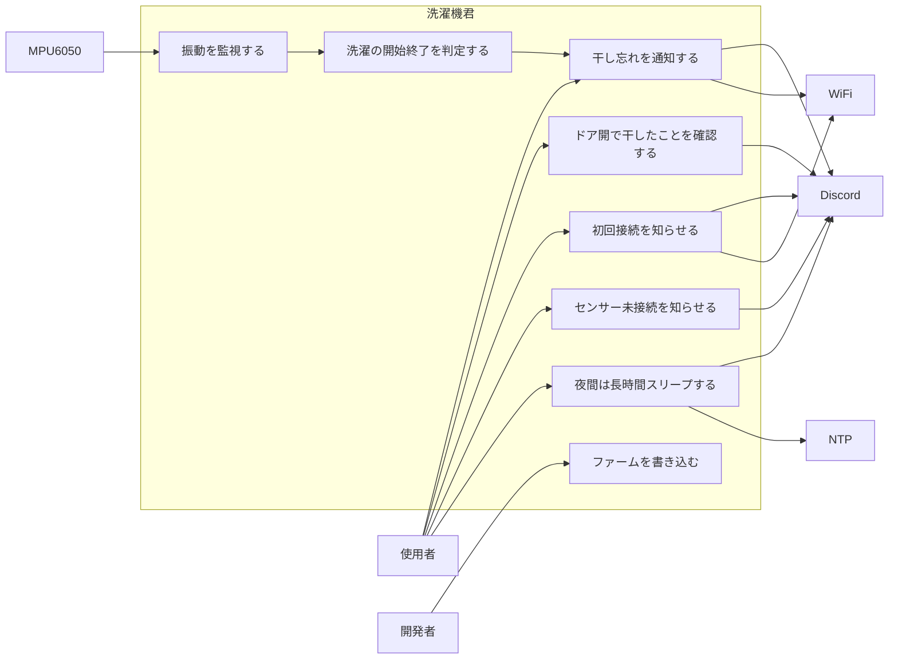
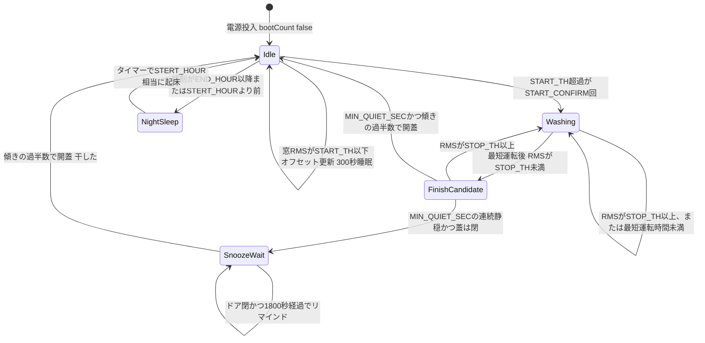
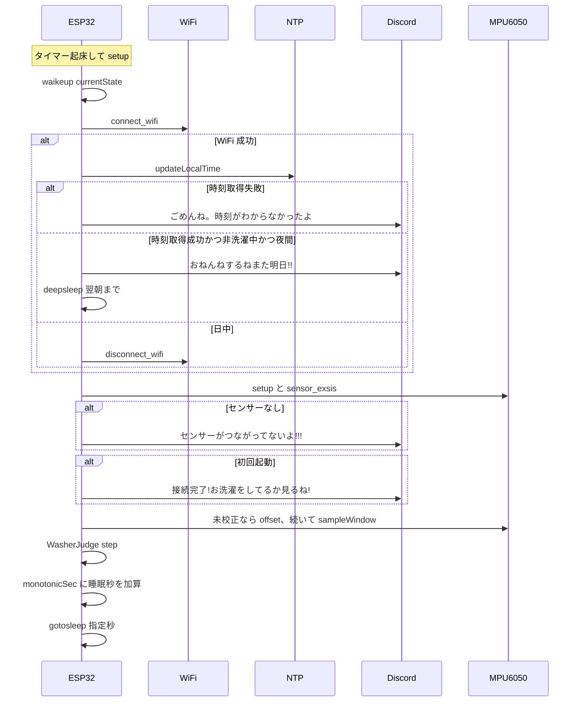
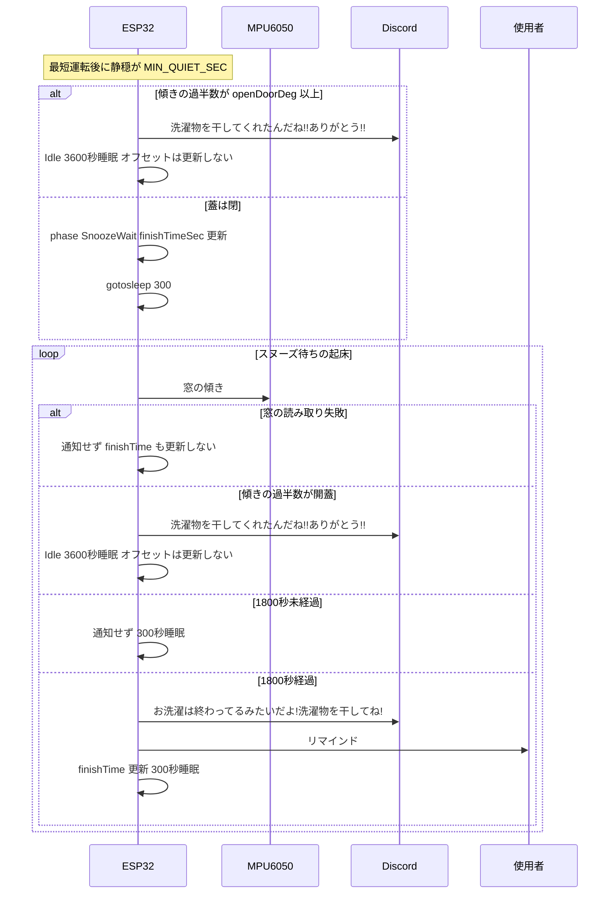
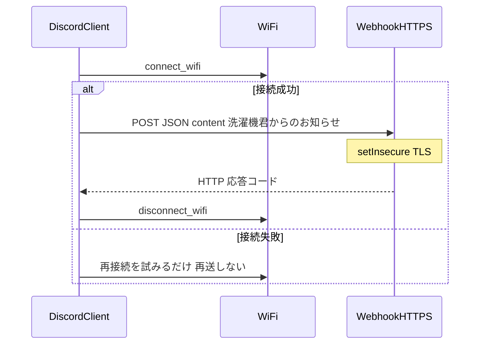

# 洗濯機君（washing-machine-sensor-for-ESP）

電池駆動の Seeed XIAO ESP32C3 が MPU6050 の振動を見て洗濯の開始・終了を推定し、干し忘れを Discord に通知するファームウェアです。連続動作ではなく、ディープスリープから起きて測って判定し、また眠るサイクルです。

機器・API・開発ツールの置き場所は [architecture.md](architecture.md) のシステム構成図を見てください。

## セットアップ

前提: [PlatformIO](https://platformio.org/)（CLI または VS Code 拡張）、ボードは Seeed XIAO ESP32C3、センサーは MPU6050（I2C アドレス `0x68`、SDA=GPIO6、SCL=GPIO7）。

```bash
cp src/config.h.exsample src/config.h
```

`src/config.h` に Wi-Fi SSID / パスワードと Discord Incoming Webhook URL を書く（このファイルは `.gitignore` 済み）。プレースホルダは `your-ssid` / `your-password` / `your-discord-webhook-url`。

```bash
pio run                         # ビルド（env: seeed_xiao_esp32c3）
pio run -t upload               # 書き込み
pio device monitor              # シリアル 115200
```

判定ロジックの native テスト:

```bash
pio test -e native
```

文化祭デモ（手で揺らして開始・停止をすぐ Discord に送る）:

```bash
pio run -e demo               # ビルド
pio run -e demo -t upload     # 書き込み
pio device monitor            # シリアル 115200
```

## 使い方

1. センサーを洗濯機に固定し、電源を入れる。
2. 初回起動時だけ Discord に「接続完了!お洗濯をしてるか見るね!」が飛ぶ。
3. 以降はタイマー起床ごとに約 3 秒の振動窓（RMS）を測る。洗濯開始・終了そのものの Discord 通知は送らない。
4. 開始は `START_TH` 超過が連続 `START_CONFIRM` 回、終了は最短運転時間のあと `STOP_TH` 未満が `MIN_QUIET_SEC` 続いたときだけ確定する。確定した時点で蓋が開いていれば干し済みにする。閉じていれば、窓の傾きが開蓋になるまで干し忘れを通知する。センサー窓の読み取りに失敗した起床では通知しない。
5. アイドルのとき、JST の 18 時以降〜8 時前は「おねんねするねまた明日!!」を送って翌朝まで寝る。

## 設定

| 名前 | 必須 | 既定値 | 説明 |
|------|------|--------|------|
| `SECRET_SSID` | はい | （config.h） | Wi-Fi SSID |
| `SECRET_PASSWORD` | はい | （config.h） | Wi-Fi パスワード |
| `DISCORD_WEBHOOK` | はい | （config.h） | Discord Incoming Webhook |
| `NTP_SERVER` | いいえ | `ntp.nict.jp` | NTP |
| `UTC` | いいえ | `9 * 3600` | JST オフセット（秒） |
| `START_TH` | いいえ | `0.90` | 開始とみなす窓 RMS（オフセット差分） |
| `STOP_TH` | いいえ | `0.40` | 終了候補とみなす窓 RMS |
| `START_CONFIRM` | いいえ | `2` | 開始確定に必要な連続起床回数 |
| `MIN_WASH_SEC` | いいえ | `1500` | 終了判定を開始するまでの最短運転（25 分） |
| `MIN_QUIET_SEC` | いいえ | `720` | 終了確定に必要な連続静穏（12 分） |
| `openDoorDeg` | いいえ | `30` | 開蓋とみなす重力の傾き（度）。閉蓋時は Z が上。窓の成功サンプルの過半数でこの角度以上なら開蓋（要調整） |
| `STERT_HOUR` | いいえ | `8` | 夜間スリープの起床時刻 |
| `END_HOUR` | いいえ | `18` | 夜間スリープ開始時刻 |
| スヌーズ間隔 | いいえ | `1800` 秒 | 干し忘れ再通知（RTC 単調秒、30 分） |
| 振動窓 | いいえ | 60 × 50 ms | 約 3 秒の RMS / 平均 / ピーク / 傾き |
| `BATT_ADC_PIN` | — | `A3` | バッテリ ADC。`getBatteryVoltage()` はあるが Discord には載せていない |

ディープスリープ秒数:

| 条件 | 秒 |
|------|----|
| 洗濯中（運転中 / 終了候補の静穏） | 300 |
| アイドル・スヌーズ待ち | 300 |
| ドア開でスヌーズ解除した直後 | 3600 |
| 夜間 | `STERT_HOUR` までの時間（時間単位） |

## 文化祭 demo

本番の洗濯判定・ディープスリープは使わず、ブースで MPU6050 を手で揺らして見せる別ビルドです。模擬洗濯機（マイクロモーター / ON-OFF）は未実装です。

1. `src/config.h` に Wi-Fi と Discord Webhook を書く。
2. `pio run -e demo -t upload` で書き込む。
3. 電源を入れると Discord に「接続完了! 文化祭デモで振動を見るね!」が飛ぶ。
4. センサーを軽く揺らすと「振動を検知したよ!」、止めると「振動が止まったよ!」が来る。何度でも繰り返せる。

`loop()` で連続サンプリングし、Wi-Fi は切らない。夜間スリープ・ドア開・干し忘れスヌーズは無効。

| 名前 | 値 | 説明 |
|------|----|------|
| 振動窓 | 20 × 50 ms | 約 1 秒の RMS |
| `START_TH` | `0.25` | 1 窓で開始 |
| `STOP_TH` | `0.15` | 連続 2 窓で停止 |
| Discord `disconnectAfter` | `false` | 送信後も Wi-Fi 維持 |

判定は `lib/DemoVibrationJudge`。本番 `WasherJudge` の定数は変えていない。

## 実行モデル

`loop()` は空です。毎回 `setup()` → `waikeup()` → サンプリング → 判定 → `SleepMode::gotosleep()` / `deepsleep()` → `esp_deep_sleep_start()` → 再起動です。

RTC メモリでディープスリープをまたぐ状態:

- `washerPhase` … Idle / Washing / FinishCandidate / SnoozeWait
- `startCount` … 開始確定用の連続超過回数
- `washStartSec` / `quietSinceSec` / `finishTimeSec` … RTC 単調秒上の時刻
- `monotonicSec` … 睡眠秒を加算した単調時計（`millis()` は使わない）
- `bootCount` … 初回挨拶済み
- `offsetIntencity` / `offsetValid` … アイドル時だけ更新する振動ベースライン

振動量は各サンプルの `intensity = |x| + |y| + |z - 9.8|` からオフセットを引いた残差の RMS です。オフセットは初回とアイドル確定時だけ更新し、洗濯中と開蓋時は固定します。蓋の傾きは `atan2(hypot(x, y), z)` の度で、成功サンプルの過半数が `openDoorDeg` 以上なら開蓋です。判定は `lib/WasherJudge` に切り出しています。

Discord の見た目は `## 洗濯機君からのお知らせ!!` と diff コードブロック（`status == true` なら `+`、`false` なら `-`）。HTTPS は `WiFiClientSecure::setInsecure()`（証明書ピン留めなし）。

未実装・動かないもの: バッテリ電圧の Discord 埋め込み、`lib/sensorcheck`（インスタンス化のみ）。

## ユースケース図



## 状態遷移図

`WasherPhase` を RTC に保持する。夜間スリープはアイドルのときだけ入る。洗濯中・終了候補・スヌーズ待ちの 18 時以降は、干し忘れ判定を続けて 300 秒間隔で起きる。



## シーケンス図

### 1 回の起床サイクル



### スヌーズ（干し忘れ）



### Discord 送信



（ペイロード見出しは「洗濯機君からのお知らせ!!」。）

## モジュール構成

| モジュール | パス | 役割 |
|------------|------|------|
| エントリ | `src/main.cpp` | 起床・センサ窓・判定の配線 |
| 判定 | `lib/WasherJudge/` | 開始・終了・スヌーズ（Arduino 非依存） |
| 文化祭判定 | `lib/DemoVibrationJudge/` | 手振りの開始・停止（Arduino 非依存） |
| 文化祭エントリ | `src/demo.cpp` | 連続サンプル。`pio run -e demo` |
| Discord | `lib/DiscordClient/` | Webhook POST |
| Network | `lib/NetworkSystem/` | STA 接続・切断 |
| Sleep | `lib/SleepMode/` | NTP、タイマー睡眠、夜間睡眠 |
| Sensor | `lib/VibrationSensor_MPU6050/` | MPU6050 加速度と窓サンプリング |
| Check | `lib/sensorcheck/` | I2C 確認（main から未使用） |

## 開発

```bash
pio run
pio run -t upload
pio device monitor
```

ボード切替の `esp32doit-devkit-v1` 環境は `platformio.ini` 内でコメントアウトされています。USB CDC は XIAO C3 向けに `ARDUINO_USB_MODE=1` と `ARDUINO_USB_CDC_ON_BOOT=1` です。外部ライブラリは `electroniccats/MPU6050`（加速度読み出し自体は `Wire` 直読み）。
