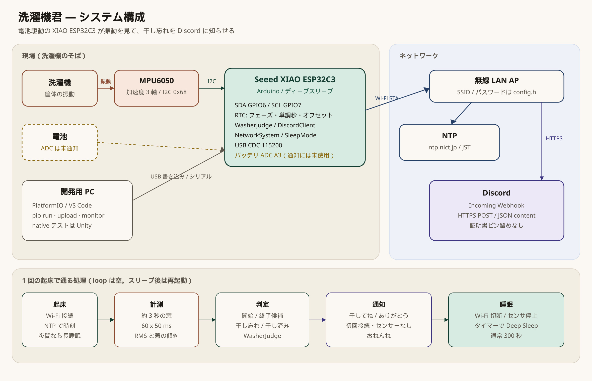
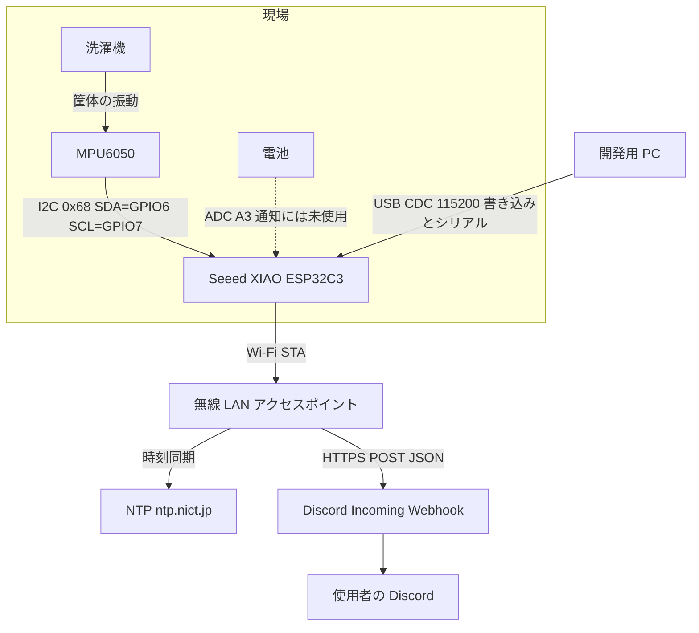
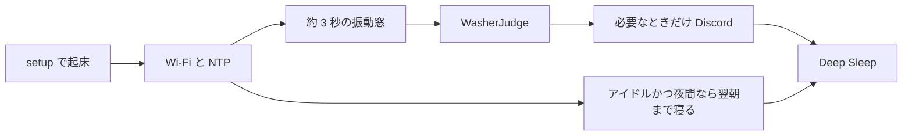
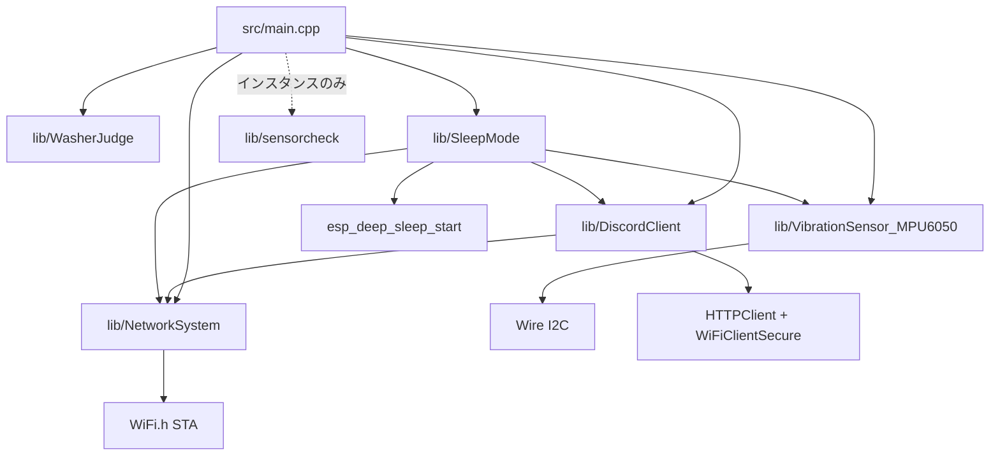

# システム構成

洗濯機の振動を Seeed XIAO ESP32C3 と MPU6050 で見て、干し忘れを Discord Incoming Webhook に送る。連続稼働ではなく、タイマーで起きて測り、判定してからディープスリープに戻る。`loop()` は空で、スリープからの復帰は再起動になる。

挙動・閾値・状態遷移は [README.md](README.md) を見てください。このページは機器・通信・ソフトウェアの置き場所です。

## 全体図

開発記事に貼るときは [system-architecture.jpg](images/system-architecture.jpg)（2360×1520）を使ってください。編集用の原図は [system-architecture.svg](images/system-architecture.svg) です。

同じ境界を Mermaid でも書いています。

## 1 回の起床

アイドルで JST 18 時以降または 8 時より前のときだけ夜間スリープに入る。洗濯中・終了候補・スヌーズ待ちは 300 秒間隔の監視を続ける。

## ファームウェアの依存

文化祭デモ用の `src/demo.cpp` と `lib/DemoVibrationJudge` は、ディープスリープと `WasherJudge` を使わない別エントリです。`platformio.ini` の `[env:demo]` は現在コメントアウトされていて、通常の `pio run` は `src/demo.cpp` をビルドしません。

## デバイス

| もの | 接続 | 役割 |
|------|------|------|
| Seeed XIAO ESP32C3 | USB、Wi-Fi、I2C、ADC | ファームウェアの実行、ディープスリープ、RTC メモリ |
| MPU6050 | I2C アドレス `0x68`、SDA=GPIO6、SCL=GPIO7 | 加速度。振動量と蓋の傾き |
| 洗濯機 | センサーを筐体に固定 | 運転中の振動源。蓋が開くとセンサーが傾く前提 |
| 電池 | `BATT_ADC_PIN`（`A3`、無ければ `D3`） | `getBatteryVoltage()` はある。Discord には載せていない |
| 開発用 PC | USB CDC、115200 | 書き込みとシリアル確認 |
| 無線 LAN AP | STA。SSID とパスワードは `src/config.h` | NTP と Discord への出口 |
| 使用者の Discord | Incoming Webhook の投稿先 | 干し忘れ、干し済み、初回接続、センサーなし、夜間スリープ、時刻取得失敗 |

加速度の換算は ±2g スケール（16384 LSB/g）を m/s² にしている。振動量は `|x| + |y| + |z - 9.8|` からオフセットを引いた残差の RMS。蓋の傾きは `atan2(hypot(x, y), z)` の度。

## 使用技術

| 層 | 名前 | 使い方 |
|----|------|--------|
| ボード | Seeed XIAO ESP32C3 | `platformio.ini` の `board = seeed_xiao_esp32c3` |
| フレームワーク | Arduino（espressif32） | `framework = arduino` |
| 言語 | C++ | `src/` と `lib/` |
| ビルド | PlatformIO | `pio run` / `pio run -t upload` / `pio device monitor` |
| エディタ | VS Code + PlatformIO IDE | `.vscode/extensions.json` の推奨拡張 |
| ホストテスト | Unity | `pio test -e native`。判定ロジックだけ |
| I2C | `Wire` | 起動時 `Wire.begin(6, 7)`。電源管理 `0x6B`、加速度 `0x3B` から 6 バイト |
| センサライブラリ | electroniccats/MPU6050 | `lib_deps` にある。読み出し自体は `Wire` 直読み |
| Wi-Fi | `WiFi.h` | `WIFI_STA`。失敗時は約 20 秒で打ち切る。送信後は `WIFI_OFF` |
| 時刻 | `configTime` / `getLocalTime` | サーバ `ntp.nict.jp`、オフセット `9 * 3600`（JST） |
| 睡眠 | `esp_sleep_enable_timer_wakeup` / `esp_deep_sleep_start` | スリープ前に Wi-Fi 切断とセンサー停止 |
| 状態保持 | `RTC_DATA_ATTR` | フェーズ、開始回数、運転・静穏・終了時刻、単調秒、初回起動、振動オフセット |
| HTTPS | `HTTPClient` + `WiFiClientSecure` | `setInsecure()`。証明書のピン留めはしない |
| 判定 | `WasherJudge` / `CyclePolicy` | Arduino に依存しない。native テストの対象 |
| デモ判定 | `DemoVibrationJudge` | 手振りの開始・停止。本番定数とは別 |
| シリアル | USB CDC | `ARDUINO_USB_MODE=1`、`ARDUINO_USB_CDC_ON_BOOT=1`、115200 |

`[env:esp32doit-devkit-v1]` も `platformio.ini` 内でコメントアウトされている。

## API

### Discord Incoming Webhook

`DiscordClient::sendMessage` が Webhook URL へ POST する。URL は `src/config.h` の `DISCORD_WEBHOOK`（gitignore 済み。見本は `src/config.h.exsample`）。

| 項目 | 内容 |
|------|------|
| メソッド | `POST` |
| ヘッダ | `Content-Type: application/json` |
| ボディ | `{"content":"..."}` |
| 本文の見た目 | `## 洗濯機君からのお知らせ!!` と diff コードブロック。`status == true` なら `+`、`false` なら `-` |
| 成功 | HTTP 200 以上 300 未満。失敗時は判定状態を戻して同じ通知をやり直す経路がある |
| TLS | `WiFiClientSecure::setInsecure()` |
| リダイレクト | `HTTPC_STRICT_FOLLOW_REDIRECTS` |
| 切断 | 既定では送信後に Wi-Fi を切る。デモは `disconnectAfter = false` |

洗濯の開始・終了そのものには Discord を送らない。干し忘れの初回は振動停止（t0）から 15 分後、再通知は 30 分おき。送るのは干し忘れ、干したことへのお礼、初回の接続完了、センサー未接続、夜間の「おねんね」、時刻取得失敗。

### NTP

`SleepMode::updateLocalTime` が `configTime(UTC, 0, NTP_SERVER)` のあと `getLocalTime` する。サーバは `ntp.nict.jp`。夜間判定に使うのはローカル時の時だけ。

### MPU6050（I2C）

| レジスタ | 操作 |
|----------|------|
| `0x6B` に `0x00` | スリープ解除（計測前） |
| `0x6B` に `0x40` | スリープ（ディープスリープ前） |
| `0x3B` から 6 バイト | 加速度 X/Y/Z の生値 |

アドレスは `0x68`。存在確認に失敗した起床では「センサーがつながってないよ!!!」を送る。窓の読み取りに失敗したときは干し忘れを送らず、終了時刻も更新しない。

### 睡眠 API

| API | 用途 |
|-----|------|
| `esp_sleep_enable_timer_wakeup` | マイクロ秒指定のタイマー起床 |
| `esp_deep_sleep_start` | ここから先は実行されない。次は `setup()` |

通常の監視は 300 秒。開蓋で干し済みにした直後は 3600 秒。夜間は次の 8 時までの時間を時単位で寝る。

## 開発ツール

| ツール | コマンドまたは場所 |
|--------|-------------------|
| PlatformIO CLI または VS Code 拡張 | `pio run`、`pio run -t upload`、`pio device monitor` |
| native テスト | `pio test -e native` |
| 秘密情報 | `cp src/config.h.exsample src/config.h` のあと SSID・パスワード・Webhook を書く |
| 推奨拡張 | `platformio.platformio-ide` |

`src/config.h` はリポジトリに含めない。

## 本番と文化祭デモ

| 項目 | 本番 `src/main.cpp` | 文化祭 `src/demo.cpp` |
|------|---------------------|------------------------|
| 実行 | `setup()` のあと Deep Sleep。`loop()` は空 | `loop()` で連続サンプリング |
| 判定 | `WasherJudge` | `DemoVibrationJudge` |
| 窓 | 60 × 50 ms | 20 × 50 ms |
| Discord | 干し忘れ系。送信後に Wi-Fi を切る | 振動の開始・停止。Wi-Fi は維持 |
| ビルド | `pio run`（`seeed_xiao_esp32c3`） | `[env:demo]` は `platformio.ini` でコメントアウト中 |

## 図に含めていないもの

- バッテリ電圧の Discord 埋め込み（関数のみ）
- `lib/sensorcheck` の計測ループ（`main` はインスタンスを作るだけ）
- 模擬洗濯機のモーター（文化祭デモでも未実装）
- 証明書ピン留め、Wi-Fi 失敗時の Webhook 再送
