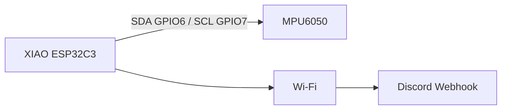
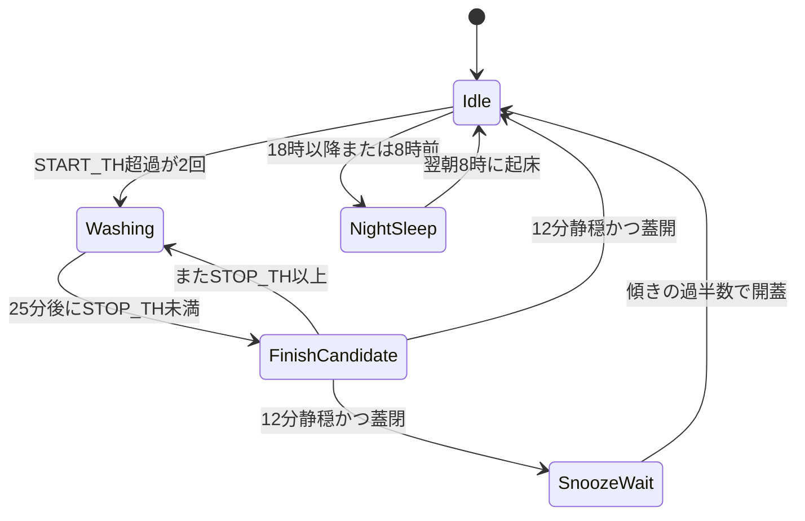

<!--
Qiita 投稿用原稿です。GitHub 上のプレビュー用に H1 を残しています。

【Qiita エディタへの貼り方】
1. タイトル欄に、下の H1（# の後ろ）をコピーする
2. タグを付ける（推奨）: ESP32 / Arduino / IoT / MPU6050 / Discord / PlatformIO
3. この HTML コメントと H1 を除いた本文を貼る（目次は Qiita が自動生成する）
4. 実機写真・Discord のスクリーンショットを「できること」「Discord 通知」の直後に入れると読まれやすい
5. 下書きプレビューで Mermaid が崩れていないか確認する（1 図 2000 文字以内）

【公開前チェック】
- Wi-Fi パスワードと Webhook URL を貼っていない
- 写真に部屋の住所・家族の顔が写っていない
- 数字・定数がこのリポジトリの実装と一致している
-->

# 洗濯物の干し忘れを Discord に知らせる「洗濯機君」を ESP32 で作った

洗濯が終わっているのに干し忘れる、という失敗を何度かやりました。ブザーはうるさいし、スマホアプリは洗濯機本体に紐づくものばかりです。そこで **Seeed XIAO ESP32C3** と **MPU6050** を洗濯機に貼り付け、振動と蓋の傾きだけを見て、干し忘れを Discord に飛ばすファームウェアを作りました。名前は「洗濯機君」です。

ソースはこちらです。

[ayappy-mugicha/washing-machine-sensor-for-ESP](https://github.com/ayappy-mugicha/washing-machine-sensor-for-ESP)

:::note info
この記事は実装の読み物です。定数の一覧・シーケンス図・モジュール表はリポジトリの [docs/README.md](https://github.com/ayappy-mugicha/washing-machine-sensor-for-ESP/blob/main/docs/README.md) が正本です。
:::

## できること

- 振動の窓 RMS から、洗濯の開始と終了を推定する
- 蓋の傾きで「もう干した」を判定する
- 蓋が閉じたままなら 30 分おきに「干してね」を Discord へ送る
- アイドルの夜（JST 18 時以降〜翌朝 8 時前）は長時間 Deep Sleep して電池を守る
- 開始・終了そのものは通知しない。うるさいのは本末転倒なので、干し忘れとお礼だけにする

Discord には例えばこんな文が来ます。

- `接続完了!お洗濯をしてるか見るね!`
- `お洗濯は終わってるみたいだよ!洗濯物を干してね!`
- `洗濯物を干してくれたんだね!!ありがとう!!`
- `おねんねするねまた明日!!`

見た目は見出し＋ diff コードブロックです。良い知らせは `+`、注意は `-` です。

```diff
## 洗濯機君からのお知らせ!!
+洗濯物を干してくれたんだね!!ありがとう!!
```

## 使うもの

| 部品 | 役割 |
|------|------|
| Seeed XIAO ESP32C3 | 本体。電池駆動を想定して Deep Sleep する |
| MPU6050 | 3 軸加速度。振動量と蓋の傾きを取る |
| Wi-Fi と Discord Incoming Webhook | 通知の出口 |
| PlatformIO | ビルドと native テスト |

配線は I2C だけです。アドレスは `0x68`、 **SDA=GPIO6**、 **SCL=GPIO7**。電源は 3.3 V です。5 V を MPU6050 に直結しないでください。



:::note warn
`src/config.h` に SSID・パスワード・Webhook URL を書きます。このファイルは `.gitignore` 済みです。記事や Issue に実値を貼らないでください。
:::

## 動きの骨格: `loop()` は空

連続サンプリングして Wi-Fi を張りっぱなし、にはしませんでした。電池が持ちません。毎回こうです。

1. タイマーで起きる
2. `setup()` が走る
3. 約 3 秒の振動窓を測る
4. 判定する
5. 必要なら Discord に送る
6. `esp_deep_sleep_start()` で眠る
7. 再起動して 1 に戻る

```cpp:src/main.cpp
void loop (){}
```

Deep Sleep をまたぐ状態は `RTC_DATA_ATTR` に置きます。`millis()` はリセットされるので使いません。睡眠秒を足し続ける単調時計 `monotonicSec` で「最短運転 25 分」「静穏 12 分」「スヌーズ 30 分」を測ります。

```cpp:src/main.cpp
RTC_DATA_ATTR uint8_t washerPhase = WASHER_IDLE;
RTC_DATA_ATTR int startCount = 0;
RTC_DATA_ATTR uint32_t washStartSec = 0;
RTC_DATA_ATTR uint32_t quietSinceSec = 0;
RTC_DATA_ATTR uint32_t finishTimeSec = 0;
RTC_DATA_ATTR uint32_t monotonicSec = 0;
RTC_DATA_ATTR bool bootCount = false;
RTC_DATA_ATTR float offsetIntencity = 0;
RTC_DATA_ATTR bool offsetValid = false;
```

睡眠秒の目安です。

| 条件 | 秒 |
|------|----|
| 運転中・終了候補・アイドル・スヌーズ待ち | 300 |
| 蓋が開いて干し済みになった直後 | 3600 |
| 夜間（アイドルのみ） | 翌朝 8 時までの時間（時間単位） |

## 振動の測り方

1 サンプルの振動量は、重力をざっくり除いた L1 ノルムです。

```cpp:lib/VibrationSensor_MPU6050/VibrationSensor6050.cpp
float VibrationSensor6050::intensityFrom(float x, float y, float z) {
    return fabsf(x) + fabsf(y) + fabsf(z - 9.8f);
}
```

本番の窓は **60 回 × 50 ms**、だいたい 3 秒です。各サンプルからアイドル時に覚えたオフセットを引き、残差の RMS を出します。成功サンプルが半数未満ならその起床は失敗扱いし、通知しません。

オフセットは初回とアイドル確定時だけ更新します。洗濯中と開蓋時は固定です。回っている最中にベースラインを追うと、脱水の谷を「静か」と誤認しやすいからです。

開始は `START_TH`（0.90）超えが連続 2 回。終了は最短 25 分運転したあと、`STOP_TH`（0.40）未満が 12 分続いたときだけ確定します。

## 状態機械

判定そのものは Arduino 非依存の `lib/WasherJudge` に切り出しています。ボードなしで `pio test -e native` が回せます。



ポイントは **終了候補** を挟んでいることです。脱水は振動が小さくなったり大きくなったりします。1 窓だけ静かでも終わりにしません。再び揺れれば運転中に戻し、静穏タイマーを捨てます。

蓋が開いたらスヌーズへ行かず、お礼を送ってアイドルに戻します。

## 蓋が開いたかの判定

MPU6050 は振動計でもあり、粗い傾き計でもあります。閉蓋時は Z が上、という置き方にしています。

```cpp:lib/WasherJudge/WasherJudge.h
inline float washerTiltDeg(float x, float y, float z) {
  const float horizontal = sqrtf((x * x) + (y * y));
  return atan2f(horizontal, z) * 57.2957795f;
}

inline bool washerDoorOpen(const WindowStats& window) {
  return window.ok && window.sampleCount > 0 &&
         (window.openCount * 2) > window.sampleCount;
}
```

1 サンプルでも 30 度を超えたら開蓋、にはしていません。窓の成功サンプルの **過半数** が `openDoorDeg`（既定 30 度）以上のときだけ開きます。センサーを貼る向きは機種で違うので、ここは実機で合わせてください。

## Discord 通知

Incoming Webhook に HTTPS POST します。ペイロードは JSON の `content` 1 本です。

```cpp:lib/DiscordClient/Discord_Client.cpp
client.setInsecure();

String symbol = (status == true) ? "+":"-";
String payload = "## 洗濯機君からのお知らせ!! \\n";
payload += "```diff\\n";
payload += symbol + message + "\\n";
payload += "```";
```

:::note warn
TLS は `WiFiClientSecure::setInsecure()` です。証明書のピン留めはありません。自宅 LAN の Webhook 通知としては動きますが、公開ネットワーク向けの堅牢さはありません。
:::

送りたいのに Wi-Fi が切れていたときは、状態を進めたままにはしません。`commitNotify()` が前回状態に戻し、短めの睡眠でリトライします。通知を「送ったつもり」でスヌーズ間隔が空くのを避けるためです。

## 実機で踏んだ穴

閾値を一度決めて終わり、にはなりませんでした。GitHub Issue に残っている失敗です。

### 1. 回していないのに「干してね」が来る

アイドルの小さな揺れや、人の通行を開始と誤ると、すぐ終了扱いになります。対策は次の 3 点です。

- 開始は 1 窓ではなく連続 2 回
- 終了判定は最短運転 25 分を待ってから
- 判定ロジックを native テストに切り出す

### 2. 脱水中なのに終わったと言われる

脱水は「静か → ドスン → 静か」を繰り返します。最短運転のあとに **連続静穏 12 分** を置いて、途中で `STOP_TH` 以上に戻ったら運転中へ戻すようにしました。

```cpp:lib/WasherJudge/WasherJudge.cpp
if (window.rms >= cfg.stopThreshold) {
  out.state.phase = WASHER_WASHING;
  out.state.quietSinceSec = 0;
  out.sleepSec = cfg.sleepWashingSec;
  return out;
}
```

この往復は `test_spin_dry_alternating_rms_does_not_confirm_finish` で固定しています。

### 3. もう干したのに「干してね」が来る

終了後すぐに蓋を開けると、スヌーズに入ってからリマインドが飛びました。窓の傾きの過半数で開蓋とし、開いていればお礼だけ送ってアイドルに戻します。

### 4. 夜になると干し忘れ通知が消える

18 時に「おねんねするねまた明日!!」が来て、そのあと「干してね」が来ない、という報告がありました。初期実装は時刻だけで長時間睡眠に入っていました。いまは **アイドルのときだけ** 夜寝します。運転中・終了候補・スヌーズ待ちの 18 時以降は 300 秒間隔のまま干し忘れを見ます。

```cpp:lib/WasherJudge/CyclePolicy.h
inline bool shouldNightSleep(uint8_t phase, int hour, int startHour, int endHour) {
  return phase == WASHER_IDLE && isNightHour(hour, startHour, endHour);
}
```

## ボードなしで判定を試す

判定と夜間ポリシーは Arduino をリンクしません。PC 上で Unity テストが走ります。

```bash
pio test -e native
```

例です。1 回のスパイクでは開始しません。

```cpp:test/test_washer_judge/test_washer_judge.cpp
void test_idle_single_spike_does_not_start() {
  const WasherJudgeConfig cfg = washerJudgeDefaultConfig();
  WasherJudgeResult first = WasherJudge::step(idleState(), windowRms(1.5f), 100, cfg);
  TEST_ASSERT_EQUAL_UINT8(WASHER_IDLE, first.state.phase);
  TEST_ASSERT_EQUAL_INT(1, first.state.startCount);

  WasherJudgeResult second = WasherJudge::step(first.state, windowRms(0.1f), 400, cfg);
  TEST_ASSERT_EQUAL_UINT8(WASHER_IDLE, second.state.phase);
  TEST_ASSERT_EQUAL_INT(0, second.state.startCount);
}
```

組み込みの「起きた・測った・眠った」を実機で再現するのは時間がかかります。閾値と状態遷移だけ先にテストできるようにしたのが、あとから効きました。

## 動かし方

前提は PlatformIO（CLI または VS Code 拡張）です。

```bash
git clone https://github.com/ayappy-mugicha/washing-machine-sensor-for-ESP.git
cd washing-machine-sensor-for-ESP
cp src/config.h.exsample src/config.h
```

`src/config.h` を自分の Wi-Fi と Discord Incoming Webhook に書き換えます。プレースホルダは `your-ssid` / `your-password` / `your-discord-webhook-url` です。

```bash
pio run                         # ビルド（env: seeed_xiao_esp32c3）
pio run -t upload               # 書き込み
pio device monitor              # シリアル 115200
```

センサーを洗濯機の上面か側面に固定して電源を入れます。初回だけ「接続完了!お洗濯をしてるか見るね!」が飛び、あとは 5 分間隔で起きて測ります。

XIAO C3 の USB シリアル向けに、`platformio.ini` では次を付けています。

```ini:platformio.ini
build_flags =
    -D ARDUINO_USB_MODE=1
    -D ARDUINO_USB_CDC_ON_BOOT=1
```

よく触る定数です。値は `washerJudgeDefaultConfig()` と `src/main.cpp` にあります。

| 名前 | 既定 | 意味 |
|------|------|------|
| `START_TH` | 0.90 | 開始とみなす窓 RMS |
| `STOP_TH` | 0.40 | 終了候補とみなす窓 RMS |
| `START_CONFIRM` | 2 | 開始確定に必要な連続起床 |
| `MIN_WASH_SEC` | 1500 | 終了判定を始めるまでの最短運転（25 分） |
| `MIN_QUIET_SEC` | 720 | 終了確定に必要な連続静穏（12 分） |
| `openDoorDeg` | 30 | 開蓋とみなす傾き（度） |
| スヌーズ | 1800 秒 | 干し忘れの再通知間隔 |

## 文化祭デモ

本番の 25 分待ちはブース向きではありません。手でセンサーを揺らして、開始と停止をすぐ Discord に出す別エントリ `src/demo.cpp` があります。Deep Sleep せず、Wi-Fi も切らない、約 1 秒窓です。

1. `platformio.ini` の `[env:demo]` ブロックのコメントを外す
2. `pio run -e demo -t upload`
3. 揺らすと「振動を検知したよ!」、止めると「振動が止まったよ!」

判定は `lib/DemoVibrationJudge` で、本番の `WasherJudge` 定数は触りません。

## まだやっていないこと

- バッテリ電圧の Discord 埋め込み（`getBatteryVoltage()` はあるが未送信）
- `lib/sensorcheck` の本採用（main からは未使用）
- TLS 証明書のピン留め
- 文化祭用の模擬洗濯機（マイクロモーター）

## おわりに

やっていることは単純で、 **起きて、3 秒測って、状態を一つ進めて、また寝る** です。難しいのは「今の静けさは終わりなのか、脱水の谷なのか、もう蓋が開いているのか」の切り分けでした。そこを RTC の状態機械と、ボードなしテストに切り出したのがこのリポジトリの中心です。

同じ悩みの人の出発点になればうれしいです。Issue や改善案も歓迎です。

- リポジトリ: [ayappy-mugicha/washing-machine-sensor-for-ESP](https://github.com/ayappy-mugicha/washing-machine-sensor-for-ESP)
- 仕様・図: [docs/README.md](https://github.com/ayappy-mugicha/washing-machine-sensor-for-ESP/blob/main/docs/README.md)
